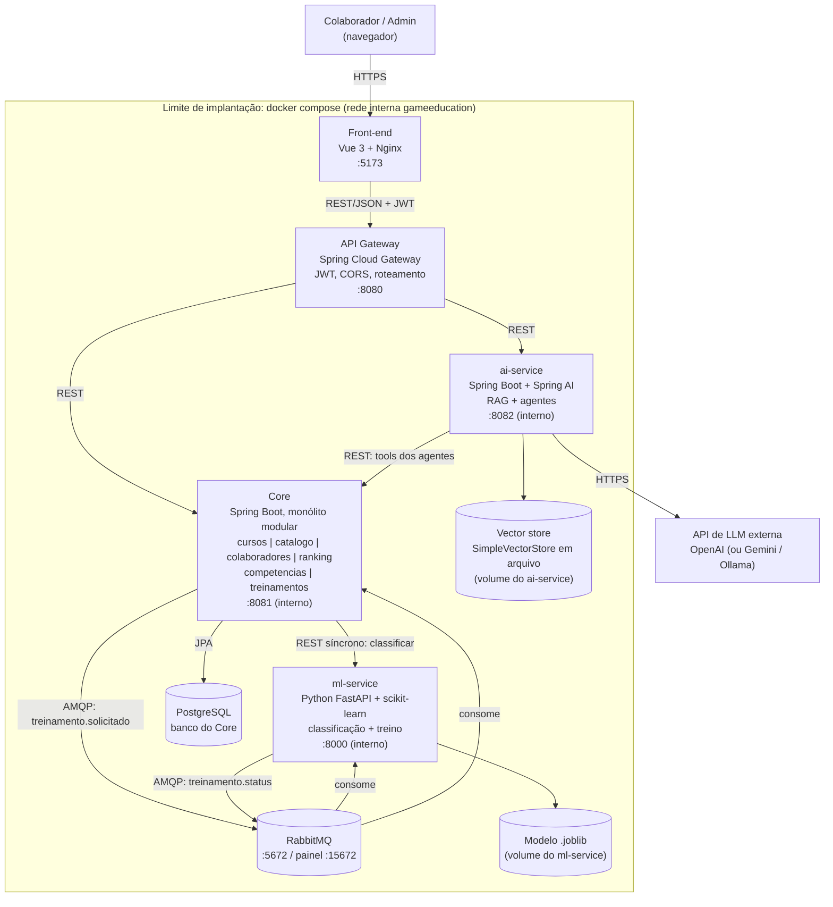
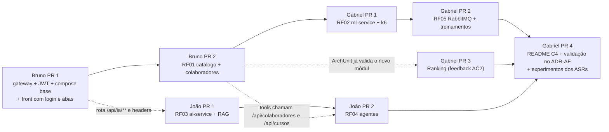

# Planejamento da AF

Este documento é o guia de execução da AF. Cada integrante lê a **Parte comum** (seções 1 a 6) e depois só a sua seção (7, 8 ou 9). Tudo o que um integrante precisa do outro está escrito como **contrato** (rota, JSON, header), então ninguém precisa esperar o código do outro ficar pronto para começar.

> **Regra de branch: a `main` está congelada.** A `main` guarda exatamente o que foi entregue na AC2 e **ninguém commita, faz merge ou abre PR para ela**. Todo o trabalho da AF parte da branch **`af`**, e todos os PRs têm a `af` como destino. Detalhes na seção 6.

Material de origem, na mesma pasta:

- [AF_Facens_v3.pdf](AF_Facens_v3.pdf): estudo de caso (RF01 a RF05, RNF01 a RNF05).
- [descricao_entrega_af.md](descricao_entrega_af.md): regras de entrega (vídeo, GitHub, docker, ordem da apresentação).
- [feedback_entrega_ac2.md](feedback_entrega_ac2.md): o que a professora pediu para evoluir.
- [checklist_validacao_af.md](checklist_validacao_af.md): checklist para validar o código de cada feature no final, com todos os PRs na `af`.

---

## 1. O que a AF exige (checklist)

| #   | Exigência                                                                                                           | Onde é atendida                                                            |
| --- | ------------------------------------------------------------------------------------------------------------------- | -------------------------------------------------------------------------- |
| 1   | Spring Boot, **Spring AI** e **FastAPI**                                                                            | Core e gateway (Spring Boot), ai-service (Spring AI), ml-service (FastAPI) |
| 2   | Requisitos inéditos (não feitos na AC1/AC2), 2 por integrante                                                       | seção 3                                                                    |
| 3   | Front e back, rodando com **`docker compose up --build`** e nenhum outro comando                                    | seção 5                                                                    |
| 4   | Commit via branch, Pull Request e merge aprovado pelo tech lead (na branch `af`, a `main` fica congelada com a AC2) | seção 6                                                                    |
| 5   | README com arquitetura **C4 completa**                                                                              | seção 10                                                                   |
| 6   | Explicar microsserviços e **gateway** (obrigatório)                                                                 | seções 2 e 7                                                               |
| 7   | Explicar **hexagonal ou clean architecture**                                                                        | seção 4                                                                    |
| 8   | Explicar comunicação **síncrona e assíncrona**, com justificativa                                                   | seção 2.3                                                                  |
| 9   | Vídeo de 20 min, YouTube não listado, **todos com câmera aberta**                                                   | seção 11                                                                   |

O que o feedback da AC2 pediu e onde entra. **Todos os itens são obrigatórios**: o feedback foi dado para esta entrega, vai ser conferido, e cada item não atendido desconta nota.

| Pedido do feedback                                                                               | Onde entra                                                                                                                                                                                                                                                                                                          | Dono           |
| ------------------------------------------------------------------------------------------------ | ------------------------------------------------------------------------------------------------------------------------------------------------------------------------------------------------------------------------------------------------------------------------------------------------------------------- | -------------- |
| Evoluir a modularização (hoje só existe `cursos`)                                                | novos módulos `catalogo`, `colaboradores`, `ranking`, `competencias`, `treinamentos` no Core                                                                                                                                                                                                                        | Bruno, Gabriel |
| **Implementar o Ranking**                                                                        | módulo `ranking` no Core, com regra de domínio em TDD (US2 da AC1) e fechamento mensal que bonifica o vencedor (seção 9.4)                                                                                                                                                                                          | Gabriel        |
| Contratos públicos entre capacidades de negócio                                                  | interfaces em `<modulo>/api/` usadas por outros módulos: `cursos → catalogo.api`, `ranking → cursos.api`, `competencias → colaboradores.api`                                                                                                                                                                        | Bruno, Gabriel |
| Corrigir dependência do contrato público com a entidade interna                                  | `AlunoResponse.from(AlunoEntity)` hoje importa `cursos.internal` (seção 7.2)                                                                                                                                                                                                                                        | Bruno          |
| C4 Container separando o atual do planejado                                                      | README novo, com legenda "implementado / planejado" em cada container e módulo (seção 10)                                                                                                                                                                                                                           | Gabriel        |
| Validar experimentalmente os atributos de qualidade **que fundamentaram a decisão arquitetural** | os 3 ASRs do ADR-001, cada um com um experimento: **manutenibilidade** com ArchUnit (seção 7.2), **escalabilidade** com k6 no ranking (seção 9.5), **complexidade operacional** com `docker stats` e contagem de containers (seção 9.5). Dos RNFs da AF: k6 da classificação (RNF01) e teste de queda do ML (RNF02) | Bruno, Gabriel |

---

## 2. Arquitetura alvo

### 2.1 Decisão: híbrida (Alternativa A do case, evoluída)

O Core de negócio **continua monólito modular** (coerente com o ADR-001 da AC2), e as capacidades de IA viram **serviços separados**, atrás de um **API Gateway**.

Por quê, em uma frase por requisito:

- **RNF04** (IA evolui sem afetar cadastro e consulta): ML e IA ficam em processos próprios. Se caírem, cadastro e consulta continuam funcionando.
- **RNF05** (custo compatível com equipe pequena): só a IA é separada. Cursos, colaboradores, competências e treinamentos ficam em um único deploy e um único banco.
- **RNF02** (aceitar treino com o ML fora do ar): RabbitMQ entre Core e ML guarda os pedidos.
- **RNF03** (dados pessoais e acesso dos agentes): o gateway é a única porta de entrada. Ele valida o JWT e repassa a identidade do usuário para os serviços.
- **Linguagens diferentes**: ML em Python e o resto em Java. Separar o ML em serviço é natural, não é escolha forçada.

Isso está registrado no **[ADR-AF](../adr/ADR-AF-arquitetura-hibrida.md)** (seção 10.2), o ADR exigido pelo item e) do case.

### 2.2 C4 nível 2 (Contêineres), arquitetura alvo da AF



### 2.3 Comunicação: quando REST e quando RabbitMQ

| Interação                                                | Tipo                    | Justificativa                                                                                                             |
| -------------------------------------------------------- | ----------------------- | ------------------------------------------------------------------------------------------------------------------------- |
| Front → Gateway → Core (cadastro e consulta, RF01)       | REST síncrono           | o usuário espera a resposta na tela, e a operação é rápida                                                                |
| Core → ml-service: classificar competência (RF02)        | REST síncrono           | precisa de resposta imediata (RNF01: p95 até 2 s). A inferência com o modelo já em memória leva milissegundos             |
| Front → Gateway → ai-service: RAG e agentes (RF03, RF04) | REST síncrono           | o usuário espera a recomendação na tela. A latência é do LLM, não da arquitetura (vai em Limitações)                      |
| ai-service → Core: tools dos agentes                     | REST síncrono           | o agente precisa do dado para continuar o raciocínio                                                                      |
| Core → ml-service: **solicitar treinamento** (RF05)      | **RabbitMQ assíncrono** | treinar demora (segundos a minutos) e não pode travar a requisição. Se o ML estiver fora, a mensagem fica na fila (RNF02) |
| ml-service → Core: **status do treinamento** (RF05)      | **RabbitMQ assíncrono** | o ML avisa o progresso (`EM_ANDAMENTO`, `CONCLUIDO`, `FALHOU`) sem conhecer o endereço do Core (desacoplamento)           |

Tratamento de falhas:

- **REST**: timeout curto (Core → ML com 1,5 s). Se o ML estiver fora, o Core responde `503` com mensagem clara, e cadastro e consulta seguem funcionando (RNF04).
- **RabbitMQ**: filas `durable`, mensagens `persistent`, ack manual no consumidor. Uma mensagem que falha vai para a DLQ (`ml.treinamento.solicitado.dlq`), sem se perder.

---

## 3. Divisão dos requisitos

| Integrante  | Requisito 1                                                                           | Requisito 2                                                                     | Pastas principais                                                                 |
| ----------- | ------------------------------------------------------------------------------------- | ------------------------------------------------------------------------------- | --------------------------------------------------------------------------------- |
| **Bruno**   | **RNF03**: API Gateway + autenticação JWT + controle de acesso                        | **RF01**: cadastro e consulta de colaboradores e cursos (novos módulos do Core) | `gateway/`, `src/main/java/.../catalogo`, `.../colaboradores`, `frontend/` (base) |
| **João**    | **RF03**: recomendação de cursos com RAG (Spring AI)                                  | **RF04**: agentes de IA com autorização do usuário                              | `ai-service/`, `frontend/js/ia.js`                                                |
| **Gabriel** | **RF02**: classificação de competência via ML (FastAPI) + teste de carga do **RNF01** | **RF05**: solicitar e acompanhar treinamento via RabbitMQ (**RNF02**)           | `ml-service/`, `src/main/java/.../competencias`, `.../treinamentos`, `loadtest/`  |

**Itens do feedback da AC2 (obrigatórios, além dos 2 requisitos de cada um):**

| Item                                                      | Dono    | Por quê                                                                                                                               |
| --------------------------------------------------------- | ------- | ------------------------------------------------------------------------------------------------------------------------------------- |
| **Ranking** (US2 da AC1)                                  | Gabriel | é a US2, escrita pelo Gabriel na AC1, e o Gabriel já fica com o fechamento da documentação. Fica no Core, sem depender da parte de IA |
| Correção do contrato `AlunoResponse` + ArchUnit           | Bruno   | já mexe nos módulos do Core no RF01                                                                                                   |
| C4 com atual x planejado, e validação dos ASRs do ADR-001 | Gabriel | consolida a documentação final                                                                                                        |

RNF04 e RNF05 não têm dono porque são consequência da arquitetura (seção 2.1). Cada um explica no vídeo como a sua parte contribui para eles.

### 3.1 Dependências e ordem



O Ranking só depende do módulo `cursos`, que já existe. O Gabriel pode fazê-lo antes do RF02 se quiser adiantar, mas é melhor esperar o PR 2 do Bruno (ArchUnit) estar na `af`, para o teste de fronteira já cobrir o módulo novo.

- **Bruno não depende de ninguém.** O PR 1 dele (gateway e compose base) deve ser o **primeiro merge**, porque mexe no `docker-compose.yml` e no front que todo mundo usa.
- **João pode começar em paralelo** ao Bruno. O ai-service é uma pasta nova. Enquanto o gateway não existe, ele testa chamando o ai-service direto e mandando os headers `X-User-*` na mão (seção 5.3). As tools do RF04 seguem o contrato da seção 5.4, e enquanto o RF01 do Bruno não estiver na `af`, ele usa um stub.
- **Gabriel fica por último**: depende do módulo `colaboradores` (RF01) para buscar os dados que vão para o ML, e consolida a documentação final.

---

## 4. Decisão: arquitetura hexagonal (portas e adaptadores)

> **Decisão tomada por Gabriel Ferreira do Nascimento em 18/11/2026: todos os serviços da AF seguem arquitetura hexagonal, e não clean architecture.** Vale desde o primeiro commit de cada PR: não é uma etapa separada para fazer depois. Registrada como "Decisão complementar" no [ADR-AF](../adr/ADR-AF-arquitetura-hibrida.md). É o conteúdo do item f do vídeo.

### 4.1 Hexagonal x clean: a diferença

As duas têm **a mesma regra central**: a regra de negócio fica no meio e não conhece framework, banco nem API externa. As dependências sempre apontam **para dentro**. O que muda é como cada uma organiza isso.

|                 | Hexagonal (portas e adaptadores)                                                                                    | Clean architecture                                                                                         |
| --------------- | ------------------------------------------------------------------------------------------------------------------- | ---------------------------------------------------------------------------------------------------------- |
| Autor           | Alistair Cockburn (2005)                                                                                            | Robert C. Martin, "Uncle Bob" (2012)                                                                       |
| Ideia           | um **núcleo** com **portas** (interfaces) e, do lado de fora, **adaptadores** que ligam cada porta a uma tecnologia | **círculos concêntricos** com camadas fixas: Entities, Use Cases, Interface Adapters, Frameworks & Drivers |
| Quantas camadas | 2 lados: dentro (núcleo) e fora (adaptadores). Não diz como organizar o núcleo por dentro                           | 4 camadas com nome e regra próprios                                                                        |
| Foco            | **trocar tecnologia externa** sem mexer no núcleo                                                                   | **isolar cada caso de uso** em uma classe própria, com input, output e presenter                           |
| Código extra    | pouco: uma interface por integração externa                                                                         | mais: um use case por operação, DTOs de entrada e saída por camada, presenters                             |

Exemplo com o RF02:

- **Hexagonal:** `ClassificadorPort` (porta) e `MlRestClassificador` (adaptador que chama o FastAPI). Se o ML mudar de lugar, troca-se só o adaptador.
- **Clean:** `ClassificarCompetenciaUseCase` + `ClassificarInput` + `ClassificarOutput` + `ClassificarPresenter` + o gateway para o ML. O mesmo resultado, com mais classes.

### 4.2 Por que hexagonal

1. **O sistema da AF é feito de integrações.** LLM (OpenAI, Gemini ou Ollama), vector store, ML em Python, RabbitMQ, REST entre serviços. O problema principal é trocar ou isolar tecnologia externa, que é exatamente o que a hexagonal resolve. A clean foca em organizar casos de uso, e aqui os casos de uso são poucos e simples.
2. **Equipe pequena e prazo curto (RNF05).** A clean exige 4 camadas e várias classes por operação. Em 3 pessoas e 2 semanas, isso vira código repetido sem ganho para a avaliação.
3. **O projeto já é hexagonal no centro.** O `domain/` da AC1 nasceu do TDD sem nenhum import de Spring (o ADR-001 já registra isso). A hexagonal só formaliza o que existe. A clean pediria reorganizar o Core em camadas novas e quebraria a estrutura `api/` + `internal/` que o feedback da AC2 elogiou.
4. **Encaixa no monólito modular do ADR-001.** O `<modulo>/api/*Api` (contrato público entre módulos) já é uma **porta de entrada**. Os outros módulos são clientes dessa porta.
5. **Facilita os testes.** Cada porta é uma interface, então o teste usa um fake no lugar do LLM, do ML ou do RabbitMQ (por exemplo um `ChatClient` mockado no RF03, ou um `ClassificadorPort` fake no RF02). Os testes não gastam chamada paga nem dependem de container.
6. **Trade-off aceito:** a hexagonal não define como organizar o núcleo por dentro, então cada serviço poderia virar de um jeito. Para evitar isso, a seção 4.3 fixa a estrutura de pastas de cada serviço, e o ArchUnit do Core (seção 7.2) barra import de framework no `domain/`.

### 4.3 Como fica em cada serviço

Vocabulário único para todo mundo:

- **Núcleo**: domínio (regras puras) + serviços de aplicação (orquestram o caso de uso).
- **Porta de entrada**: o que o mundo pode pedir ao núcleo. Ex: `CatalogoApi`, `CursosApi`.
- **Porta de saída**: o que o núcleo precisa do mundo. Ex: `ClassificadorPort`, `BaseConhecimento`.
- **Adaptador de entrada**: quem chama o núcleo. Ex: controller REST, listener RabbitMQ.
- **Adaptador de saída**: quem implementa uma porta de saída. Ex: JPA, `RestClient`, Spring AI, pika.

**Core (Spring Boot).** Mantém o `api/` + `internal/` por módulo (é a fronteira do ADR-001) e aplica a hexagonal dentro dele:

```
domain/                   núcleo puro (Aluno, Curso, Plano, RankingMensal). Sem Spring, sem JPA
<modulo>/api/             porta de entrada (interface *Api + records) e adaptador de entrada (Controller)
<modulo>/internal/        serviço de aplicação (implementa o *Api), portas de saída (*Port)
                          e adaptadores de saída (Entity/Repository JPA, RestClient, RabbitTemplate)
```

| Módulo          | Porta de entrada                         | Porta de saída                | Adaptador de saída                          |
| --------------- | ---------------------------------------- | ----------------------------- | ------------------------------------------- |
| `catalogo`      | `CatalogoApi`                            | (JPA direto pelo repository)  | `CursoCatalogoRepository`                   |
| `colaboradores` | `ColaboradoresApi`                       | (JPA)                         | `ColaboradorRepository`                     |
| `cursos`        | `CursosApi`                              | `CatalogoApi` de outro módulo | `AlunoRepository`                           |
| `ranking`       | `RankingController`                      | `CursosApi` de outro módulo   | `ParticipacaoRepository`                    |
| `competencias`  | controller                               | `ClassificadorPort`           | `MlRestClassificador` (REST para o FastAPI) |
| `treinamentos`  | controller + `StatusTreinamentoListener` | `PublicadorTreinamentoPort`   | `RabbitPublicadorTreinamento`               |

Para o JPA não se cria porta própria: o `JpaRepository` do Spring já é uma interface, e criar outra por cima só para o banco seria cerimônia sem ganho. Essa simplificação é consciente e vale citar no vídeo.

**ai-service (Spring AI), João:**

```
ai-service/src/main/java/.../
  domain/                    Recomendacao, PlanoDeAcao, AcaoAgente (regra autorizar/negar), StatusAcao. Sem Spring
  application/               RecomendacaoService, OrientacaoService
  application/port/          BaseConhecimento, ModeloLinguagem, CoreGateway, RepositorioAcoes
  adapters/in/web/           controllers REST
  adapters/in/tools/         classes com @Tool (o LLM chama o núcleo por elas)
  adapters/out/vectorstore/  VectorStoreBaseConhecimento (Spring AI)
  adapters/out/llm/          SpringAiModeloLinguagem (ChatClient)
  adapters/out/core/         RestCoreGateway e StubCoreGateway
  adapters/out/persistence/  AcaoAgenteEntity + repository JPA (converte de e para o domain)
```

**ml-service (FastAPI), Gabriel:** a estrutura já está na seção 9.1 (`domain/`, `application/`, `adapters/`).

**gateway (Bruno):** é infraestrutura pura (rotas, JWT, filtros) e não tem regra de negócio, então não aplica hexagonal. Vale dizer isso no vídeo: a decisão vale onde existe domínio.

### 4.4 O que mostrar no vídeo (item f)

1. Abrir o `domain/` do Core e mostrar que não há import de Spring (com o ArchUnit garantindo).
2. Abrir uma porta de saída (`ClassificadorPort` ou `BaseConhecimento`) e o adaptador dela.
3. Mostrar a troca de provedor de LLM só pelo `.env` (OpenAI para Gemini). O adaptador muda de configuração e o núcleo não muda.
4. Mostrar um teste unitário usando um fake no lugar da porta.

---

## 5. Base técnica comum (contratos que todo mundo segue)

### 5.1 Estrutura de pastas final

O Core **continua na raiz** do repo, para não mover arquivos e não gerar conflito com o que já existe. Os serviços novos entram em pastas irmãs.

```
/                         Core (Spring Boot 4.1.1, já existe)
  src/main/java/com/example/grupo_5_gameeducation/
    domain/               regra pura da AC1 (não mexer)
    cursos/               US1, já existe (api/ + internal/)
    catalogo/             RF01 (Bruno)        api/ + internal/
    colaboradores/        RF01 (Bruno)        api/ + internal/
    ranking/              feedback AC2 (Gabriel) api/ + internal/
    competencias/         RF02 (Gabriel)      api/ + internal/
    treinamentos/         RF05 (Gabriel)      api/ + internal/
gateway/                  RNF03 (Bruno)       projeto Maven próprio
ai-service/               RF03 + RF04 (João)  projeto Maven próprio
ml-service/               RF02 + RF05 (Gabriel) projeto Python
frontend/
  index.html              casca: login, abas, helper de API (Bruno)
  js/colaboradores.js     aba do RF01 (Bruno)
  js/ia.js                aba do RF03/RF04 (João)
  js/ml.js                aba do RF02/RF05 (Gabriel)
  js/ranking.js           aba do Ranking (Gabriel)
loadtest/                 k6 do RNF01 (Gabriel)
docs/adr/ADR-AF-arquitetura-hibrida.md   decisão da AF (já escrita)
```

Atenção ao `.dockerignore` da raiz: o build do Core usa a raiz como contexto. Quem criar uma pasta nova adiciona ela no `.dockerignore` (`gateway/`, `ai-service/`, `ml-service/`, `loadtest/`, `frontend/`, `docs/`, `evidencias/`), senão o build do Core fica lento e invalida o cache.

### 5.2 Portas e containers

| Serviço (nome no compose) | Porta interna | Publicada no host?                        | Dono          |
| ------------------------- | ------------- | ----------------------------------------- | ------------- |
| `frontend`                | 80            | **5173**                                  | Bruno (casca) |
| `gateway`                 | 8080          | **8080** (única porta de API para fora)   | Bruno         |
| `app` (Core)              | 8081          | não (só na rede interna)                  | já existe     |
| `ai-service`              | 8082          | não                                       | João          |
| `ml-service`              | 8000          | não                                       | Gabriel       |
| `db` (Postgres)           | 5432          | 5432 (para o pgAdmin/debug)               | já existe     |
| `pgadmin`                 | 80            | 5050                                      | já existe     |
| `rabbitmq`                | 5672 / 15672  | **15672** (painel, para mostrar no vídeo) | Gabriel       |

O front continua chamando `http://localhost:8080`, que agora é o gateway. Por isso o valor padrão de `apiBase` no `index.html` não muda.

Durante o desenvolvimento, quem quiser testar um serviço direto pode publicar a porta num `docker-compose.override.yml` (já está no `.gitignore`). Na versão final, só o gateway fica exposto, e isso é argumento do RNF03.

Todo serviço novo precisa de `healthcheck` no compose, e quem depende dele usa `depends_on: condition: service_healthy`. Sem isso, o `docker compose up --build` sobe tudo ao mesmo tempo e o Core tenta conectar no RabbitMQ antes dele estar pronto.

### 5.3 Contrato de identidade (gateway → serviços)

O gateway valida o JWT e **repassa a identidade em headers**. Os serviços **não validam JWT**, só leem os headers.

| Header             | Exemplo                                                               | Significado                                            |
| ------------------ | --------------------------------------------------------------------- | ------------------------------------------------------ |
| `X-User-Id`        | `ana`                                                                 | login do usuário                                       |
| `X-User-Roles`     | `COLABORADOR` ou `ADMIN` (separados por vírgula se houver mais de um) | papéis                                                 |
| `X-Colaborador-Id` | `1`                                                                   | id do colaborador ligado ao usuário (vazio para admin) |

Regras de segurança (o Bruno implementa no gateway, os outros só confiam):

1. O gateway **remove** qualquer `X-User-*` ou `X-Colaborador-Id` que venha do cliente, antes de adicionar os verdadeiros. Sem isso, qualquer um forjaria ser admin.
2. Core, ai-service e ml-service **não publicam porta** no host. Só são alcançáveis pela rede interna do compose, então o único caminho até eles é o gateway.

Usuários fixos para demo (em memória no gateway, senha com BCrypt):

| Login    | Senha       | Papel         | Colaborador |
| -------- | ----------- | ------------- | ----------- |
| `admin`  | `admin123`  | `ADMIN`       | (nenhum)    |
| `ana`    | `ana123`    | `COLABORADOR` | 1           |
| `carlos` | `carlos123` | `COLABORADOR` | 2           |

O Core cria os colaboradores 1 (Ana) e 2 (Carlos) por seed (seção 7.2), para os ids baterem.

### 5.4 Contratos REST (via gateway, base `http://localhost:8080`)

Todas as rotas `/api/**` exigem `Authorization: Bearer <jwt>`. Erros seguem um formato único: `{"erro": "mensagem legível"}`.

**Autenticação (Bruno, gateway)**

| Método | Rota          | Corpo                              | Resposta                                                                              |
| ------ | ------------- | ---------------------------------- | ------------------------------------------------------------------------------------- |
| POST   | `/auth/login` | `{"login":"ana","senha":"ana123"}` | `200 {"token":"...","login":"ana","roles":["COLABORADOR"],"colaboradorId":1}` / `401` |

**RF01 (Bruno, Core)**

| Método | Rota                      | Quem pode                      | Resposta                    |
| ------ | ------------------------- | ------------------------------ | --------------------------- |
| POST   | `/api/cursos`             | ADMIN                          | `201 CursoResponse`         |
| GET    | `/api/cursos?area=DEVOPS` | todos                          | `200 [CursoResponse]`       |
| GET    | `/api/cursos/{id}`        | todos                          | `200 CursoResponse` / `404` |
| POST   | `/api/colaboradores`      | ADMIN                          | `201 ColaboradorResponse`   |
| GET    | `/api/colaboradores`      | ADMIN                          | `200 [ColaboradorResponse]` |
| GET    | `/api/colaboradores/{id}` | ADMIN ou o próprio colaborador | `200` / `403` / `404`       |

```json
// CursoResponse
{"id": 1, "titulo": "Docker na Prática", "area": "DEVOPS", "nivel": "INTERMEDIARIO", "cargaHoraria": 20}

// ColaboradorResponse (email aparece mascarado para quem não é ADMIN: "a***@empresa.com")
{"id": 1, "nome": "Ana Souza", "email": "ana@empresa.com", "cargo": "Analista de QA",
 "area": "QA", "anosExperiencia": 3, "cursosConcluidos": 4, "mediaNotas": 8.1}
```

Enums: `area` = `DEVOPS | QA | DESENVOLVIMENTO | DADOS | GESTAO`; `nivel` = `INICIANTE | INTERMEDIARIO | AVANCADO | ESPECIALISTA` (o mesmo enum usado pelo ML).

**RF02 (Gabriel, Core chama o ML)**

| Método | Rota                                  | Corpo                             | Resposta                                                                                                         |
| ------ | ------------------------------------- | --------------------------------- | ---------------------------------------------------------------------------------------------------------------- |
| POST   | `/api/colaboradores/{id}/competencia` | `{"notaAvaliacao": 78}` (0 a 100) | `200 {"colaboradorId":1,"nivel":"INTERMEDIARIO","confianca":0.82,"versaoModelo":3}` / `503` se o ML estiver fora |

**RF05 (Gabriel, Core + RabbitMQ)**

| Método | Rota                     | Corpo                                                           | Resposta                                                                                                   |
| ------ | ------------------------ | --------------------------------------------------------------- | ---------------------------------------------------------------------------------------------------------- |
| POST   | `/api/treinamentos`      | `{"descricao":"retreino com novas avaliações","amostras":2000}` | **`202`** `{"id":7,"status":"PENDENTE",...}`                                                               |
| GET    | `/api/treinamentos`      |                                                                 | `200 [SolicitacaoResponse]`                                                                                |
| GET    | `/api/treinamentos/{id}` |                                                                 | `200 {"id":7,"status":"CONCLUIDO","acuracia":0.91,"versaoModelo":4,"criadoEm":"...","atualizadoEm":"..."}` |

Status: `PENDENTE → EM_ANDAMENTO → CONCLUIDO | FALHOU`.

**Ranking (Gabriel, Core, feedback AC2)**

| Método | Rota                               | Quem pode | Corpo / Resposta                                                                            |
| ------ | ---------------------------------- | --------- | ------------------------------------------------------------------------------------------- |
| POST   | `/api/ranking/participacoes`       | todos     | `{"alunoId":1,"tipo":"TOPICO"}` ou `"COMENTARIO"` → `201`                                   |
| GET    | `/api/ranking?mes=2026-11&top=10`  | todos     | `200 [{"posicao":1,"alunoId":1,"nome":"Ana","topicos":5,"comentarios":12,"pontos":22}]`     |
| POST   | `/api/ranking/fechamentos/2026-11` | ADMIN     | `200 {"mes":"2026-11","vencedorAlunoId":1,"cursosBonus":1}` / `409` se o mês já foi fechado |

**RF03 e RF04 (João, ai-service)**

| Método | Rota                                   | Corpo                                          | Resposta                                                                      |
| ------ | -------------------------------------- | ---------------------------------------------- | ----------------------------------------------------------------------------- |
| POST   | `/api/ia/recomendacoes`                | `{"objetivo":"quero crescer em DevOps"}`       | `200 {"resposta":"...","cursos":[...],"fontes":["politica-trilhas.md", ...]}` |
| POST   | `/api/ia/agentes/orientacao`           | `{"objetivo":"montar meu plano do trimestre"}` | `200 PlanoDeAcao` com ações `AGUARDANDO_AUTORIZACAO`                          |
| POST   | `/api/ia/agentes/acoes/{id}/autorizar` |                                                | `200 AcaoAgente` executada                                                    |
| POST   | `/api/ia/agentes/acoes/{id}/negar`     |                                                | `200 AcaoAgente` cancelada                                                    |
| GET    | `/api/ia/agentes/acoes`                |                                                | `200 [AcaoAgente]` do usuário logado                                          |

### 5.5 Contrato RabbitMQ (Gabriel)

| Item               | Valor                                                                                           |
| ------------------ | ----------------------------------------------------------------------------------------------- |
| Exchange           | `ml.treinamento` (tipo `direct`, durable)                                                       |
| Fila de pedidos    | `ml.treinamento.solicitado` (durable, DLX para `ml.treinamento.solicitado.dlq`)                 |
| Fila de status     | `ml.treinamento.status` (durable)                                                               |
| Mensagem de pedido | `{"solicitacaoId":7,"amostras":2000,"solicitadoPor":"admin","criadoEm":"2026-11-20T10:00:00Z"}` |
| Mensagem de status | `{"solicitacaoId":7,"status":"CONCLUIDO","acuracia":0.91,"versaoModelo":4,"mensagem":null}`     |

Quem declara filas e exchange: **os dois lados** (Core e ml-service) declaram de forma idempotente na subida. Assim tanto faz quem sobe primeiro.

### 5.6 LLM (Spring AI)

- Provedor padrão: **OpenAI**, com a chave que a professora forneceu, via `spring-ai-starter-model-openai`.
- A chave fica em um arquivo **`.env` na raiz, que NÃO vai para o git** (adicionar `.env` no `.gitignore`). No repo vai só o `.env.example`:

  ```
  OPENAI_API_KEY=
  # Opcional, para trocar de provedor sem mudar código:
  # Gemini: OPENAI_BASE_URL=https://generativelanguage.googleapis.com/v1beta/openai
  # Ollama: OPENAI_BASE_URL=http://host.docker.internal:11434
  OPENAI_BASE_URL=https://api.openai.com
  OPENAI_CHAT_MODEL=gpt-4o-mini
  OPENAI_EMBEDDING_MODEL=text-embedding-3-small
  ```

- O compose lê o `.env` sozinho (sem comando extra), então `docker compose up --build` continua sendo o único comando.
- Gemini e Ollama têm endpoint compatível com a API da OpenAI. Trocar de provedor é só mudar `OPENAI_BASE_URL` e os nomes dos modelos (no Gemini, pode ser preciso ajustar também `completions-path` e `embeddings-path`, conferir na doc do Spring AI). Isso é um bom exemplo de adaptador da arquitetura hexagonal para o vídeo.
- **Sem chave, nada pode quebrar**: o ai-service sobe normalmente e as rotas de IA respondem `503 {"erro":"LLM não configurado: defina OPENAI_API_KEY no .env"}`. O resto do sistema funciona (RNF04). Ver detalhes na seção 8.

### 5.7 Versões (atenção)

O Core está em **Spring Boot 4.1.1**. Spring Cloud Gateway e Spring AI podem ainda não ter versão estável compatível com o Boot 4.1. Como gateway e ai-service são **projetos separados**, cada um pode usar a combinação estável que o [start.spring.io](https://start.spring.io) oferecer (por exemplo Boot 3.5.x + Spring Cloud 2025.0.x, e Boot 3.5.x + Spring AI 1.x). Gerar o projeto pelo start.spring.io com as dependências marcadas já resolve, porque ele só deixa marcar combinações compatíveis. Anotar a versão escolhida no README.

---

## 6. Fluxo de Git (obrigatório para a nota)

### 6.1 A `main` não é mais usada

| Branch                 | Papel                                                                                                    | Quem mexe                                           |
| ---------------------- | -------------------------------------------------------------------------------------------------------- | --------------------------------------------------- |
| `main`                 | **congelada**: guarda exatamente o estado entregue na AC2 (commit `40226a2`), para a professora comparar | **ninguém**. Sem commit, sem merge, sem PR para ela |
| `af`                   | branch de integração da AF. Nasce da `main` e recebe os PRs de todos                                     | só recebe merge de PR aprovado pelo tech lead       |
| `feat/...`, `docs/...` | uma por requisito, sempre criada **a partir da `af`**                                                    | o dono do requisito                                 |

Cuidado no GitHub: ao abrir o PR, o destino padrão vem como `main`. **Trocar o "base" para `af` em todo PR.** Para evitar o erro, o tech lead pode, em Settings > Branches, criar uma regra de proteção na `main` (bloqueando push e merge).

Na entrega, o link do GitHub enviado deve apontar para a branch da AF (`https://github.com/<org>/<repo>/tree/af`), e o README da `af` deve dizer, logo no início, que a `main` guarda a AC2.

### 6.2 Criar a branch `af` (só uma vez, feito pelo tech lead)

1. Ir para a `main` atualizada.
   ```
   git checkout main
   ```
   ```
   git pull origin main
   ```
2. Criar a `af` a partir dela.
   ```
   git checkout -b af
   ```
3. Commitar este planejamento e o material da AF (`docs/contexts_af/`) na `af`, para todos terem acesso.
   ```
   git add docs/contexts_af/
   ```
   ```
   git commit -m "docs: add af case, ac2 feedback and execution plan"
   ```
4. Publicar a `af`.
   ```
   git push -u origin af
   ```

### 6.3 Branches dos requisitos

Cada requisito é **uma branch e um PR para a `af`**. O tech lead revisa e faz o merge. Cada integrante commita **com a própria conta** (a professora olha os autores dos commits).

| Ordem        | Branch                           | Dono    | Depende de               |
| ------------ | -------------------------------- | ------- | ------------------------ |
| 1            | `feat/rnf03-gateway-auth`        | Bruno   | nada                     |
| 2            | `feat/rf01-colaboradores-cursos` | Bruno   | 1                        |
| 2 (paralelo) | `feat/rf03-rag-recomendacao`     | João    | nada (merge depois do 1) |
| 3            | `feat/rf04-agentes-ia`           | João    | RF03, contrato do RF01   |
| 4            | `feat/rf02-classificacao-ml`     | Gabriel | RF01                     |
| 5            | `feat/rf05-treinamento-rabbitmq` | Gabriel | RF02                     |
| 5 (paralelo) | `feat/ranking`                   | Gabriel | RF01 (ArchUnit)          |
| 6            | `docs/af-c4-adr`                 | Gabriel | todos                    |

### 6.4 Passo a passo de cada branch

1. Atualizar a `af` local.
   ```
   git checkout af
   ```
   ```
   git pull origin af
   ```
2. Criar a branch do requisito a partir da `af`.
   ```
   git checkout -b feat/rf01-colaboradores-cursos
   ```
3. Commits pequenos, em inglês, com prefixo `feat` / `fix` / `refactor` / `chore` / `docs`. Exemplo: `feat: add course catalog module with public api contract`.
4. Antes de abrir o PR, trazer a `af` de novo e resolver conflitos (o mais comum vai ser no `docker-compose.yml` e no `frontend/index.html`).
   ```
   git pull origin af
   ```
5. Rodar a checagem mínima: `./mvnw clean verify` (Java) ou `pytest` (Python), e depois `docker compose up --build` do zero.
6. Enviar a branch.
   ```
   git push -u origin feat/rf01-colaboradores-cursos
   ```
7. Abrir o PR no GitHub com **base `af`** (não `main`!), título igual ao do requisito e descrição curta: o que foi feito, como testar, print. **Não fazer merge do próprio PR**: o tech lead aprova e faz o merge.
8. Tirar print do PR aprovado e mergeado (vai para o vídeo e para `evidencias/`).

**Definição de pronto de cada requisito:**

- [ ] Funciona com `docker compose up --build` a partir de um clone limpo (sem passo manual).
- [ ] Tem tela no front (mesmo que simples).
- [ ] Tem pelo menos um teste automatizado da regra principal.
- [ ] Rotas aparecem no Swagger do serviço (Java) ou no `/docs` do FastAPI.
- [ ] Segue a hexagonal da seção 4: domínio sem import de framework, integração externa sempre atrás de uma porta, pastas como na seção 4.3.
- [ ] Seção própria no README (o que faz, rotas, decisões, como testar).
- [ ] Prints em `evidencias/af/<requisito>/`.

---

## 7. Bruno: RNF03 (gateway e acesso) + RF01 (colaboradores e cursos)

### 7.1 RNF03: API Gateway com JWT e controle de acesso

**Objetivo:** criar a única porta de entrada da API. Ela autentica o usuário, aplica regras de acesso por papel e repassa a identidade para os serviços.

**O que explicar no vídeo:** por que um gateway (ponto único de entrada, segurança centralizada, os serviços internos não ficam expostos, roteamento para Core, IA e ML), e como isso protege dados pessoais (RNF03).

**Passo a passo:**

1. Gerar `gateway/` no start.spring.io: Maven, Java 17, dependências **Reactive Gateway** (Spring Cloud Gateway), **Spring Security**, **OAuth2 Resource Server** e **Spring Boot Actuator** (para o healthcheck). Ver a seção 5.7 sobre versões.
2. `gateway/src/main/resources/application.yml` com as rotas:

   | Rota                     | Destino                       |
   | ------------------------ | ----------------------------- |
   | `/api/ia/**`             | `http://ai-service:8082`      |
   | `/api/**` (todo o resto) | `http://app:8081`             |
   | `/auth/**`               | atendido pelo próprio gateway |

   As URLs vêm de variáveis de ambiente com default (`${CORE_URL:http://localhost:8081}`), para rodar fora do docker também. A rota `/api/ia/**` precisa vir **antes** de `/api/**`.

3. **Login** (`AuthController` no gateway): `POST /auth/login` confere login e senha nos usuários em memória da seção 5.3 (BCrypt) e devolve um JWT HS256 assinado com `JWT_SECRET` (env, com default de dev). Claims: `sub` (login), `roles`, `colaboradorId`. Expiração de 2 h. Usar `NimbusJwtEncoder` com `ImmutableSecret`, que já vem com o resource server.
4. **Validação**: `SecurityWebFilterChain` com `oauth2ResourceServer().jwt()` e `NimbusReactiveJwtDecoder.withSecretKey(...)`.
   - `permitAll`: `/auth/**`, `/actuator/health`, `OPTIONS /**`.
   - `hasRole('ADMIN')`: `POST /api/cursos`, `POST /api/colaboradores`, `GET /api/colaboradores` (listar todos), `POST /api/treinamentos`, `POST /api/ranking/fechamentos/**`.
   - `authenticated`: todo o resto de `/api/**`.
5. **Filtro de identidade** (`GlobalFilter`): remove `X-User-Id`, `X-User-Roles` e `X-Colaborador-Id` da requisição original e adiciona os valores tirados do JWT validado (seção 5.3). Esse é o ponto mais importante para mostrar no vídeo.
6. **CORS no gateway** (`globalcors` no yml), liberando `http://localhost:*`. Depois, apagar o `CorsConfig` do Core, porque o navegador não fala mais com o Core direto. Se ficar CORS nos dois, o navegador recebe header duplicado e bloqueia.
7. `gateway/Dockerfile` multi-stage, igual ao da raiz.
8. `docker-compose.yml`:
   - Adicionar o serviço `gateway` (porta `8080:8080`, `depends_on: app`, healthcheck em `/actuator/health`).
   - Mudar o `app` para `server.port=8081` (no `application-docker.properties`) e **remover o `ports`** dele.
   - Adicionar `env_file` opcional e `JWT_SECRET`.
   - Criar `.env.example` na raiz e adicionar `.env` no `.gitignore`.
9. **Front base** (`frontend/index.html`): tela de login, guarda o token em `sessionStorage`, o helper `api()` passa a mandar `Authorization: Bearer`, faz logout no `401`, e cria a navegação em **abas**. Cada aba carrega um arquivo `frontend/js/<aba>.js` com um componente Vue (via `<script src>`, sem build). Deixar `js/ia.js`, `js/ml.js` e `js/ranking.js` criados com um componente "em construção", para João e Gabriel só preencherem. **Isso evita conflito de merge no `index.html`.**
10. Testes (`gateway/src/test`): com `WebTestClient`, sem token em `/api/cursos` dá `401`; `ana` tentando `POST /api/cursos` dá `403`; o header `X-User-Roles: ADMIN` enviado pelo cliente é sobrescrito.

**Evidências:** print do `401` e do `403` no Postman ou curl, print do login no front, e `docker ps` mostrando que só o gateway publica porta de API.

### 7.2 RF01: cadastro e consulta de colaboradores e cursos

**Objetivo:** criar duas capacidades de negócio novas no Core, cada uma com **contrato público** usado por outro módulo. É o que o feedback pediu: modularização além de `cursos` e contratos entre módulos.

**Por que é inédito:** a AC1/AC2 só tinha "aluno" para a gamificação. Catálogo de cursos e cadastro corporativo de colaboradores não existiam.

**Passo a passo:**

1. **Corrigir o vazamento apontado no feedback:** `cursos/api/AlunoResponse.java` importa `cursos.internal.AlunoEntity` (método `from`). Mover a conversão para `cursos/internal` (por exemplo um `AlunoMapper` no internal, ou o `AlunoService` montando o `AlunoResponse`). Regra: **nada em `*/api` importa `*/internal`**. O sentido certo é `internal → api`.
2. **Módulo `catalogo`:**
   ```
   catalogo/api/CatalogoApi.java          interface pública: buscarPorId, listar(area), existe(titulo)
   catalogo/api/CursoResumo.java          record público devolvido pelo contrato
   catalogo/api/CursoController.java      REST /api/cursos
   catalogo/api/CriarCursoRequest.java, CursoResponse.java
   catalogo/api/Area.java, Nivel.java     enums (seção 5.4)
   catalogo/internal/CursoCatalogoEntity.java, CursoCatalogoRepository.java
   catalogo/internal/CatalogoService.java implementa CatalogoApi
   ```
3. **Módulo `colaboradores`:** mesma estrutura, com `ColaboradoresApi` (contrato público: `buscarPerfil(id)` devolvendo `PerfilColaborador` com `anosExperiencia`, `cursosConcluidos`, `mediaNotas`). **Esse contrato é o que o Gabriel vai consumir no RF02**, então ele precisa estar estável.
4. **Uso real de contrato entre módulos (mostrar no vídeo):** em `cursos/internal/AlunoService.concluirCurso`, validar pelo `CatalogoApi` que o curso concluído existe no catálogo antes de aplicar a regra da US1. Assim `cursos` depende de `catalogo.api`, nunca de `catalogo.internal`.
5. **Acesso e dados pessoais (complementa o RNF03):** o controller lê `X-User-Roles` e `X-Colaborador-Id`. `GET /api/colaboradores/{id}` só para ADMIN ou o próprio colaborador (senão `403`). Email mascarado para quem não é ADMIN. Não guardar CPF, porque não é necessário (minimização, LGPD).
6. **Seed** (`CommandLineRunner` ou `data.sql`, só se a tabela estiver vazia): uns 10 cursos em áreas variadas, e os colaboradores 1 (Ana) e 2 (Carlos), batendo com os usuários do gateway.
7. **Teste de arquitetura com ArchUnit** (dependência `com.tngtech.archunit:archunit-junit5`, escopo test): "classes de um módulo não acessam o pacote `internal` de outro módulo", "`..api..` não depende de `..internal..`" e "`..domain..` não depende de `org.springframework..` nem de `jakarta..`" (garante a regra da hexagonal, seção 4). Esse é o experimento de **modularidade** que o feedback pediu: se alguém quebrar a fronteira, o build falha.
8. Testes do serviço: criar curso, listar por área, colaborador não encontrado dá `404`, colaborador acessando outro dá `403`.
9. Aba "Colaboradores e Cursos" em `frontend/js/colaboradores.js`: listar e cadastrar cursos (cadastro só aparece para admin), e ver o perfil do colaborador.

**Evidências:** `./mvnw clean verify` verde com o ArchUnit, print do ArchUnit falhando quando se força um import errado (ótimo para o vídeo), e telas.

---

## 8. João: RF03 (RAG) + RF04 (agentes com autorização)

### 8.1 RF03: recomendar cursos com RAG

**Objetivo:** o colaborador descreve um objetivo ("quero crescer em DevOps") e o sistema recomenda cursos **com base em documentos institucionais**, citando as fontes.

**O que explicar no vídeo:** o que é RAG (recuperar trechos relevantes, colocar no prompt e só então gerar), por que isso reduz alucinação, e por que é um serviço separado (RNF04: evolui sozinho, e se cair não afeta o cadastro).

**Passo a passo:**

1. Gerar `ai-service/` no start.spring.io: Maven, Java 17, **Spring Web**, **OpenAI** (Spring AI), **Spring Boot Actuator**, **H2** e **Spring Data JPA** (para guardar as ações do RF04). Ver a seção 5.7.
2. **Documentos institucionais** em `ai-service/src/main/resources/docs/`, escritos pelo grupo (4 a 6 arquivos `.md` curtos e realistas). Sugestões:
   - `politica-de-trilhas.md`: quais cursos compõem cada trilha por área e nível.
   - `matriz-de-competencias.md`: o que se espera de INICIANTE, INTERMEDIARIO, AVANCADO e ESPECIALISTA em cada área.
   - `politica-de-desenvolvimento.md`: horas de treino por ano, pré-requisitos, regras de aprovação.
   - `catalogo-cursos.md`: descrição dos cursos do seed do Bruno (mesmos títulos!).
   - `faq-rh.md`.
3. **Ingestão** (`IngestaoDocumentos`, roda na subida): lê os `.md`, quebra em pedaços com `TokenTextSplitter`, gera embeddings e salva num **`SimpleVectorStore`** persistido em arquivo (`/data/vectorstore.json`, num volume do compose). Se o arquivo já existe, só carrega e não paga embedding de novo.
   - Por que `SimpleVectorStore` e não pgvector: são poucos documentos, e não colocar mais um banco é coerente com o RNF05. Citar isso como trade-off: para milhares de documentos, trocar o adaptador por pgvector.
4. **Porta e adaptador**: interface `BaseConhecimento { List<Trecho> buscar(String pergunta, int k); }`, implementada por `VectorStoreBaseConhecimento`. O `RecomendacaoService` só conhece a interface.
5. **`RecomendacaoService`**: busca top-k = 4 trechos e monta o prompt com o objetivo do usuário, os trechos recuperados e, quando houver, o nível de competência (vem do RF02 do Gabriel se existir; se não, ignora). Chama o `ChatClient`, pedindo a resposta em formato estruturado (`.entity(Recomendacao.class)`) com `resposta`, `cursos[]` e `fontes[]`. O system prompt manda **recomendar só cursos que aparecem nos trechos** e dizer "não encontrei nos documentos" quando não houver base.
6. **Sem chave de LLM** (seção 5.6): se `OPENAI_API_KEY` estiver vazia, a ingestão não roda e o serviço sobe mesmo assim. As rotas devolvem `503` com mensagem clara. **Testar esse caso**, porque o professor pode rodar sem chave.
7. `POST /api/ia/recomendacoes` (contrato na seção 5.4). Ler `X-User-Id` e `X-Colaborador-Id` dos headers.
8. Dockerfile multi-stage, serviço `ai-service` no compose (sem `ports`, `env_file: .env` com `required: false`, volume `aidata:/data`, healthcheck), e a rota `/api/ia/**` já existe no gateway do Bruno.
9. Testes: teste de unidade do `RecomendacaoService` com `BaseConhecimento` e `ChatClient` mockados, para não gastar chamada de LLM no `mvn verify`.
10. Aba "Assistente IA" em `frontend/js/ia.js`: campo de objetivo, resposta, lista de cursos e fontes.

**Enquanto o gateway não existe:** publicar a porta 8082 num `docker-compose.override.yml` e chamar direto com `-H "X-User-Id: ana" -H "X-User-Roles: COLABORADOR" -H "X-Colaborador-Id: 1"`.

### 8.2 RF04: agentes de IA com autorização do usuário

**Objetivo:** um agente de orientação analisa o colaborador e **propõe** ações (ex: "inscrever no curso X", "agendar acompanhamento em 30 dias"). **Nenhuma ação que altera dados é executada sem o usuário clicar em autorizar.** Isso cobre "com autorização do usuário" (RF04) e "controlar o acesso dos agentes às ferramentas" (RNF03).

**O que explicar no vídeo:** o que é tool calling, a diferença entre tools de **leitura** (o agente usa sozinho) e tools de **ação** (só propõe, o humano autoriza), e o controle de acesso por papel.

**Passo a passo:**

1. **Tools de leitura** (métodos com `@Tool` do Spring AI, que o agente chama sozinho):
   - `consultarPerfil(colaboradorId)`: chama `GET /api/colaboradores/{id}` do Core **repassando os headers do usuário logado**. Assim o agente nunca vê dados que o próprio usuário não poderia ver (RNF03).
   - `listarCursos(area)`: `GET /api/cursos?area=`.
   - `buscarDocumentos(pergunta)`: reutiliza a `BaseConhecimento` do RF03.
   - Chamada ao Core via porta `CoreGateway` (interface) com adaptador `RestClient` para `http://app:8081` (env `CORE_URL`). **Enquanto o RF01 do Bruno não estiver na `af`**, usar um adaptador stub que devolve dados fixos, ativado por `@Profile("stub")` ou por propriedade.
2. **Tools de ação** (o agente **não executa**, só registra uma proposta):
   - `proporInscricao(colaboradorId, cursoId, motivo)` e `proporAcompanhamento(colaboradorId, dias, motivo)`. Elas apenas criam uma `AcaoAgente` com status `AGUARDANDO_AUTORIZACAO` (entidade JPA no H2 do ai-service).
3. **Controle de acesso do agente (RNF03):**
   - Um `COLABORADOR` só pode pedir orientação para **si mesmo**: o `colaboradorId` usado vem sempre do header `X-Colaborador-Id`, nunca do texto do usuário (isso evita prompt injection do tipo "me mostre os dados do Carlos").
   - Só o dono da ação (ou ADMIN) pode autorizar ou negar.
   - Registrar quem autorizou e quando (`autorizadoPor`, `autorizadoEm`), para auditoria.
4. **Fluxo:**
   ```mermaid
   sequenceDiagram
       actor U as Colaborador
       participant GW as Gateway
       participant AI as ai-service (agente)
       participant C as Core
       U->>GW: POST /api/ia/agentes/orientacao {objetivo}
       GW->>AI: + X-User-*, X-Colaborador-Id
       AI->>C: tool consultarPerfil / listarCursos
       AI->>AI: tool buscarDocumentos (RAG)
       AI->>AI: tool proporInscricao -> AcaoAgente AGUARDANDO_AUTORIZACAO
       AI-->>U: PlanoDeAcao (explicação + ações pendentes)
       U->>GW: POST /api/ia/agentes/acoes/{id}/autorizar
       GW->>AI: autorizar
       AI->>AI: valida dono, executa, status EXECUTADA
       AI-->>U: ação executada
   ```
5. **Executar uma ação autorizada:** a `inscricao` vira um registro de plano de estudos no ai-service, e o `acompanhamento` vira um lembrete com data. Se der tempo, a inscrição pode chamar uma rota do Core, mas não é obrigatório: o que vale para o RF04 é o **fluxo de autorização**.
6. Testes: um `COLABORADOR` autorizando a ação de outro dá `403`; ação negada não executa; uma tool de ação chamada nunca muda status para `EXECUTADA` sem autorização.
7. Na aba "Assistente IA": botão "Pedir orientação", lista de ações com os botões **Autorizar** e **Negar**, e histórico.

**Evidências:** prints do plano proposto, da ação autorizada, do `403` ao autorizar ação de outro usuário, e do log mostrando as tools que o agente chamou.

---

## 9. Gabriel: RF02 (classificação ML) + RF05 (treinamento via RabbitMQ)

Pode ser feito por último: depende do contrato `ColaboradoresApi` do Bruno (seção 7.2).

### 9.1 RF02: classificar nível de competência com ML

**Objetivo:** o colaborador faz uma avaliação (nota 0 a 100) e o sistema classifica o nível com um modelo de ML, combinando a nota com o histórico dele.

**Passo a passo:**

1. **`ml-service/`** (Python 3.12, FastAPI, scikit-learn, joblib, pika, uvicorn, pytest), em hexagonal (seção 4):
   ```
   ml-service/
     app/domain/nivel.py                   enum Nivel
     app/domain/ports.py                   Classificador, RepositorioModelo, PublicadorStatus (Protocols)
     app/application/classificar.py        caso de uso
     app/application/treinar.py            caso de uso (RF05)
     app/adapters/http_api.py              FastAPI: POST /classificar, GET /modelo, GET /health
     app/adapters/sklearn_classificador.py RandomForest
     app/adapters/joblib_repositorio.py    salva e carrega /models/modelo.joblib
     app/adapters/rabbit_consumer.py       RF05
     app/dataset.py                        gera dataset sintético rotulado
     tests/
     Dockerfile, requirements.txt
   ```
2. **Dataset sintético** (`dataset.py`): features `anos_experiencia`, `cursos_concluidos`, `media_notas`, `nota_avaliacao`. O rótulo vem de uma regra com ruído (ex: score ponderado com cortes em 4 níveis). Documentar no README que é sintético (vai em Limitações).
3. **Na subida:** se `/models/modelo.joblib` não existe, treina a versão 1. O modelo fica **carregado em memória**, e é isso que garante a latência do RNF01.
4. `POST /classificar` com `{"anosExperiencia":3,"cursosConcluidos":4,"mediaNotas":8.1,"notaAvaliacao":78}` devolve `{"nivel":"INTERMEDIARIO","confianca":0.82,"versaoModelo":1}`.
5. **No Core, módulo `competencias`:**
   - `competencias/internal/ClassificadorPort` com adaptador `MlRestClassificador` (`RestClient`, `ML_URL=http://ml-service:8000`, timeout de 1,5 s).
   - O `CompetenciaService` busca o perfil via **`ColaboradoresApi`** (contrato público do Bruno, sem acessar o `internal` dele; o ArchUnit garante) e chama o ML.
   - `POST /api/colaboradores/{id}/competencia` (contrato na seção 5.4). Se o ML estiver fora, responde `503 {"erro":"Serviço de classificação indisponível"}`, e o resto do Core segue normal (RNF04).
   - Opcional: guardar o histórico de classificações para mostrar a evolução do colaborador.
6. Compose: serviço `ml-service` (sem `ports`, volume `mlmodels:/models`, healthcheck em `/health`). Rodar o uvicorn com `--workers 2` para aguentar a carga.
7. Testes: `pytest` do caso de uso com um classificador fake, e teste do `CompetenciaService` com o `ClassificadorPort` mockado (incluindo o caso de ML fora, que dá `503`).
8. Aba "Competências e ML" em `frontend/js/ml.js`: escolher o colaborador, digitar a nota e ver nível e confiança.

### 9.2 RNF01: teste de carga (evidência experimental)

**Objetivo:** provar com número que 95% das classificações respondem em até 2 s com 300 usuários simultâneos.

1. `loadtest/classificacao.js` (k6): faz o login no `setup()`, depois 300 VUs por 1 minuto chamando `POST http://localhost:8080/api/colaboradores/1/competencia` pelo **gateway** (caminho real completo), com `thresholds: { http_req_duration: ['p(95)<2000'], http_req_failed: ['rate<0.01'] }`.
2. Rodar via docker (sem instalar k6), com a stack no ar:
   ```
   docker run --rm -i --network host grafana/k6 run - < loadtest/classificacao.js
   ```
3. Guardar o resumo (print e `--summary-export loadtest/resultado.json`) e registrar no README: p95 obtido, máquina usada, e a ressalva de que é ambiente local com tudo na mesma máquina.
4. Se não passar: aumentar workers do uvicorn, o pool de conexões HTTP do `RestClient` no Core, ou retirar o histórico do caminho síncrono. Documentar o que foi ajustado: isso é exatamente a "validação experimental" que o feedback pediu.

### 9.3 RF05 + RNF02: solicitar e acompanhar treinamento via RabbitMQ

**Objetivo:** o admin pede um retreino do modelo, o pedido é aceito na hora (`202`) mesmo com o ML fora do ar, e o usuário acompanha o status até concluir.

**Passo a passo:**

1. Compose: serviço `rabbitmq` (`rabbitmq:3.13-management`, painel em `15672:15672`, healthcheck com `rabbitmq-diagnostics -q ping`, usuário e senha por env). `app` e `ml-service` com `depends_on: rabbitmq: condition: service_healthy`.
2. **Core, módulo `treinamentos`:**
   - Dependência `spring-boot-starter-amqp` no `pom.xml`.
   - `treinamentos/internal/config/RabbitConfig`: exchange, filas, DLQ e binding da seção 5.5, mais o `Jackson2JsonMessageConverter`.
   - `SolicitacaoTreinamentoEntity` (Postgres): `id`, `descricao`, `amostras`, `status`, `acuracia`, `versaoModelo`, `solicitadoPor`, `criadoEm`, `atualizadoEm`.
   - `POST /api/treinamentos`: salva como `PENDENTE`, publica em `ml.treinamento.solicitado` e responde **`202 Accepted`**. Isso é o centro do RNF02: o Core só depende do RabbitMQ estar no ar, não do ML.
   - `StatusTreinamentoListener` (`@RabbitListener` em `ml.treinamento.status`): atualiza a entidade.
   - Por simplicidade, salvar e publicar ficam na mesma operação (sem padrão outbox). Citar o outbox em Limitações.
3. **ml-service:** `rabbit_consumer.py` roda numa thread de fundo, iniciada no `lifespan` do FastAPI, com `prefetch_count=1` e **ack manual só depois de terminar**. Ao receber o pedido:
   - publica `EM_ANDAMENTO`;
   - gera o dataset com `amostras`, treina, mede a acurácia num conjunto de teste e salva a nova versão;
   - troca o modelo em memória (o `/classificar` passa a usar a versão nova sem reiniciar);
   - publica `CONCLUIDO` com acurácia e versão, ou `FALHOU` com a mensagem, e dá `nack` sem requeue (a mensagem vai para a DLQ).
   - Conexão com retry: se o RabbitMQ não estiver pronto, tenta de novo a cada 5 s, sem derrubar o FastAPI.
4. Na aba "Competências e ML": botão "Solicitar treinamento" (só admin) e tabela com as solicitações, atualizando o status a cada 3 s (polling simples no front).
5. **Experimento do RNF02 (gravar isso no vídeo):**
   1. Parar o ML.
      ```
      docker compose stop ml-service
      ```
   2. Solicitar 2 treinamentos pelo front. Os dois respondem na hora e ficam `PENDENTE`.
   3. Mostrar as 2 mensagens prontas na fila `ml.treinamento.solicitado` no painel do RabbitMQ (`http://localhost:15672`).
   4. Subir o ML de novo.
      ```
      docker compose start ml-service
      ```
   5. Os status passam por `EM_ANDAMENTO` e chegam em `CONCLUIDO`, e a `versaoModelo` sobe.
6. Testes: no Core, que o `POST` responde `202` e publica a mensagem (`RabbitTemplate` mockado), e que o listener atualiza o status. No Python, o caso de uso `treinar` com repositório e publicador fakes.

### 9.4 Ranking (feedback da AC2, obrigatório)

**Objetivo:** implementar a US2 da AC1 ("o aluno que mais escreve tópicos no fórum e ajuda colegas com comentários ganha 1 curso no fim do mês"). O ranking foi o motivo do ADR-001 (o módulo que cresce mais que os outros), então ele precisa existir e ser medido.

**O que explicar no vídeo:** é um módulo novo que nasceu no lugar previsto pelo ADR-001 (`ranking/api` + `ranking/internal`) sem mexer em `cursos`. Ele usa o **contrato público** `cursos.api` para dar o curso bônus, e o teste de carga prova o ASR de escalabilidade.

**Passo a passo:**

1. **BDD primeiro** (mesmo padrão da AC1, com tabela Dado que / Quando / Então no README). Pelo menos 3 cenários:
   - aluno com mais pontos no mês é o vencedor e ganha 1 curso liberado;
   - empate em pontos: vence quem tem mais comentários (ajudou mais colegas) e, se ainda empatar, quem teve a primeira participação mais cedo;
   - o mesmo mês não pode ser fechado duas vezes (não bonifica de novo).
2. **TDD do domínio puro** em `domain/RankingMensal.java`, sem Spring, igual ao `Aluno` da AC1: `registrar(alunoId, tipo, quando)`, `classificacao()` e `vencedor()`. Pontuação: tópico = 2 pontos, comentário = 1 ponto, em constantes com nome de negócio. Ciclo RED, GREEN e REFACTOR com prints e JaCoCo em 100% no domínio, como na AC1.
3. **Contrato público do `cursos`:** criar `cursos/api/CursosApi.java` com `void bonificar(Long alunoId, int quantidade, String motivo)`, implementado em `cursos/internal/AlunoService`. Para isso, o `Aluno` do domínio e a `AlunoEntity` ganham um método `bonificar(int)` que soma em `cursosLiberados` (com teste).
4. **Módulo `ranking`:**

   ```
   ranking/api/RankingController.java      rotas da seção 5.4
   ranking/api/RegistrarParticipacaoRequest.java, PosicaoRankingResponse.java, FechamentoResponse.java
   ranking/internal/ParticipacaoEntity.java alunoId, tipo, registradaEm
   ranking/internal/FechamentoMensalEntity.java mes (único), vencedorAlunoId, fechadoEm
   ranking/internal/ParticipacaoRepository.java consulta agregada por mês (GROUP BY alunoId)
   ranking/internal/RankingService.java     monta o RankingMensal do domínio e fecha o mês
   ```

   - O `RankingService` chama `CursosApi.bonificar(...)`, **nunca** o `AlunoService` ou o `AlunoRepository` direto. O ArchUnit do Bruno vai acusar se isso for quebrado.
   - Fechar um mês já fechado dá `409` (constraint única em `mes` mais checagem no serviço).

5. **Leitura rápida para escalar:** a consulta do ranking usa agregação no banco (`GROUP BY`) com índice em `(registradaEm, alunoId)`. Não carregar todas as participações em memória.
6. Seed com participações de alguns alunos no mês atual, para o ranking não aparecer vazio na demo.
7. Testes: domínio (TDD), serviço (fechamento chama `CursosApi.bonificar` uma única vez; mês repetido dá `409`).
8. Aba "Ranking" no front: tabela do mês, botões para registrar tópico e comentário, e botão "Fechar mês" (só admin), mostrando depois que o vencedor ganhou +1 curso liberado.

### 9.5 Experimentos dos ASRs do ADR-001 (feedback: "validar experimentalmente")

O ADR-001 escolheu o monólito modular por 3 ASRs. Cada um ganha uma evidência medida, registrada na tabela "Validação" do ADR-AF (hoje com "a medir") e no README:

| ASR do ADR-001           | Experimento                                                                                                                                                                                    | Resultado esperado para registrar                                                                       |
| ------------------------ | ---------------------------------------------------------------------------------------------------------------------------------------------------------------------------------------------- | ------------------------------------------------------------------------------------------------------- |
| Manutenibilidade         | ArchUnit do Bruno (seção 7.2) com 6 módulos no Core, e o print dele falhando quando se força um import de `internal`                                                                           | fronteiras garantidas pelo build. O Ranking entrou sem alterar `cursos/internal` (mostrar o diff do PR) |
| Escalabilidade (ranking) | `loadtest/ranking.js` (k6): 300 VUs lendo `GET /api/ranking` e 50 VUs registrando participações, por 1 min, pelo gateway                                                                       | p95 e taxa de erro. Comparar com e sem o índice do passo 5 da seção 9.4 é um bom "antes e depois"       |
| Complexidade operacional | `docker stats --no-stream` com a stack inteira no ar, mais uma contagem de quantos containers e bancos existem e quantos existiriam se o Core fosse quebrado em microsserviços (Alternativa B) | memória e CPU por container, e a justificativa de por que o Core continua um container só               |

Rodar o k6 do ranking com a stack no ar:

```
docker run --rm -i --network host grafana/k6 run - < loadtest/ranking.js
```

### 9.6 Documentação final (Gabriel consolida, cada um escreve a sua parte)

Ver a seção 10. Cada integrante escreve a seção do próprio requisito no README **dentro do PR dele**. O Gabriel junta, escreve o C4 final e preenche a tabela "Validação" do ADR-AF com os resultados, no PR `docs/af-c4-adr`.

---

## 10. Documentação (README com C4)

### 10.1 Estrutura do README novo

O README atual é todo da AC1 (ATDD). Na AF ele vira o README da plataforma, e o conteúdo da AC1 vai para `docs/ac1-atdd.md` (com link no README, para não perder nada).

1. **Nome do projeto** (precisa ter um nome! Sugestão: manter "GameEducation" e usar como subtítulo "Plataforma de Educação Corporativa Inteligente"), equipe com RA, data. Logo abaixo, um aviso: "Esta é a branch `af`. O estado entregue na AC2 está preservado na `main`."
2. Problema da AF e tabela de requisitos, com o dono de cada um.
3. **Como rodar**: `cp .env.example .env` (opcional, para a IA), `docker compose up --build`, URLs e usuários de demo.
4. **C4 nível 1, Contexto**: colaborador, admin, a plataforma e a API de LLM externa.
5. **C4 nível 2, Contêineres**: o diagrama da seção 2.2, com legenda de **o que está implementado** (o feedback pediu essa distinção explícita).
6. **C4 nível 3, Componentes**: um para o Core (módulos e contratos `api` entre eles), um para o ai-service (RAG, agente, tools, portas) e um para o ml-service (portas e adaptadores).
7. **C4 nível 4, Código** (opcional, curto): o diagrama de classes do `domain/Aluno` da AC1 já serve.
8. Comunicação síncrona e assíncrona: a tabela da seção 2.3.
9. Arquitetura hexagonal (decisão e justificativa): a seção 4.
10. Uma seção por requisito (escrita pelo dono).
11. Evidências: testes, ArchUnit, k6 (classificação e ranking), RNF02, `docker stats`, prints dos PRs.
12. **Atendimento ao feedback da AC2**: uma tabela com cada ponto do feedback e onde foi resolvido (link para o código ou a seção). Assim a professora confere tudo num lugar só.
13. **Limitações** e **Próximos passos** (seção 12).

### 10.2 ADR da AF (já escrito)

Um único ADR para a AF, que é o que o item e) do case pede: **[docs/adr/ADR-AF-arquitetura-hibrida.md](../adr/ADR-AF-arquitetura-hibrida.md)**. O nome não segue a numeração dos desafios do B1, porque só o Desafio 1 foi feito (ADR-001) e os demais foram substituídos pela AF.

O que ele já cobre: contexto, alternativas A, B e C, decisão híbrida, justificativa, os 3 ASRs (RNF04, RNF02, RNF03), REST x RabbitMQ, a decisão complementar da hexagonal (seção 4), trade-offs e gatilho de revisão. Isso responde aos itens a), c), d) e e) do case.

O que falta, e fica com o Gabriel no PR `docs/af-c4-adr`: preencher a tabela "Validação" com os resultados medidos (hoje está "a medir"), e ajustar o texto se alguma decisão mudar durante a implementação.

O registro de desafios em [docs/arquitetura/README.md](../arquitetura/README.md) já foi atualizado: os desafios 2 a 6 aparecem como "não realizado (substituído pela AF)", com link para o ADR-AF.

---

## 11. Roteiro do vídeo (20 min, câmera aberta de todos o tempo todo)

| Item obrigatório                    | Quem                                                                                  | Tempo              | O que mostrar                                                         |
| ----------------------------------- | ------------------------------------------------------------------------------------- | ------------------ | --------------------------------------------------------------------- |
| a) Equipe, nome, RA, projeto, data  | todos (cada um se apresenta)                                                          | 1 min              |                                                                       |
| b) Problema e requisitos            | Gabriel                                                                               | 1,5 min            | tabela de requisitos com donos                                        |
| c) C4 pelo README                   | Gabriel                                                                               | 2,5 min            | níveis 1, 2 e 3 no GitHub                                             |
| d) Serviços e módulos implementados | cada um, a sua parte (Gabriel inclui o Ranking e a tabela de atendimento ao feedback) | 7,5 min (2,5 cada) | código + tela + PR mergeado na `af`                                   |
| e) Microsserviços e gateway         | Bruno                                                                                 | 1,5 min            | rotas, JWT, headers, só o gateway exposto                             |
| f) Hexagonal / clean                | João                                                                                  | 1,5 min            | portas e adaptadores no ai-service e no ml-service, `domain/` do Core |
| g) Síncrono e assíncrono            | Gabriel                                                                               | 2 min              | tabela 2.3 + demo do RNF02 (ML parado, fila no painel)                |
| h) Limitações                       | Bruno                                                                                 | 1 min              | seção 12                                                              |
| i) Considerações finais             | João                                                                                  | 1 min              |                                                                       |

Ensaiar uma vez cronometrando. Antes de gravar, rodar `docker compose down -v` e depois `docker compose up --build` num clone limpo, para provar que tudo sobe só com esse comando.

---

## 12. Limitações já conhecidas (para o README e o vídeo)

- Dataset de ML sintético: o modelo demonstra o fluxo, não tem validade estatística real.
- Teste de carga em máquina local, com todos os containers juntos: não representa produção.
- Usuários fixos em memória no gateway (sem cadastro de usuários nem refresh token).
- Sem padrão outbox: se o Core cair entre salvar e publicar, a solicitação fica `PENDENTE` sem mensagem.
- `SimpleVectorStore` não escala para muitos documentos (trocar o adaptador por pgvector).
- RAG e agentes dependem de uma API de LLM paga e externa. Sem chave, essas rotas ficam indisponíveis (por design, o resto funciona).
- Ranking sem fórum real: as participações (tópico e comentário) são registradas pela API, não por um fórum de verdade. O fechamento do mês é disparado pelo admin, não por agendamento automático.
- Ranking continua dentro do Core: se o k6 mostrar gargalo em produção, o próximo passo é extrair o módulo (Alternativa C do ADR-001), que já está isolado.
